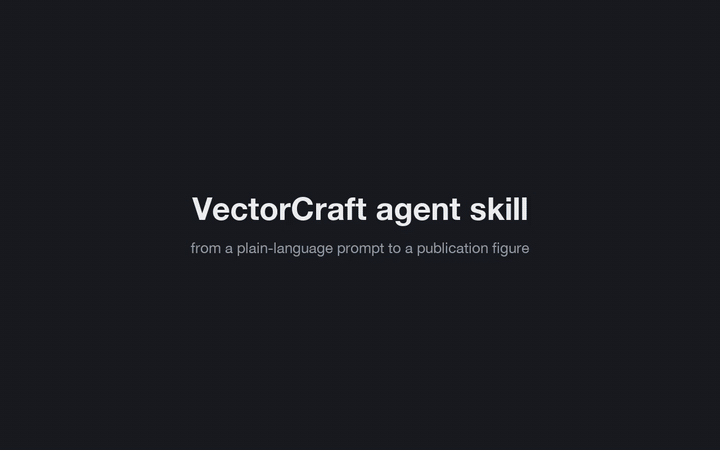

# craftapps-skill

An agent skill that drives the Craft desktop apps through their JSON control ports. Your agent works in the window you have open, as a live copilot
on what you've selected, or builds whole results independently while you watch. It can also teach you to do the same steps by hand.

| App | Like | Examples |
|---|---|---|
| [VectorCraft](https://github.com/storytold/vectorcraft) | Illustrator | figures, multi-artboard documents, revisions, LaTeX math, TikZ-style arrows |
| [SolidCraft](https://github.com/tangency-labs/solidcraft) | Fusion | parametric parts, assemblies and joints, STEP import and export |
| [PhotoCraft](https://github.com/storytold/photocraft) | Photoshop | non-destructive layers, masks, annotation, batch processing |
| [DesignCraft](https://github.com/storytold/designcraft) | InDesign | multi-page layouts, styles, tables, PDF export |

[](media/demo.mp4)

*VectorCraft, recorded live at ×6 speed. The prompts are in [`demo/prompts`](demo/prompts), the exported files in [`demo/output`](demo/output), and the full-quality
video is [`media/demo.mp4`](media/demo.mp4).*

## Quickstart

1. **Install the skill** by putting the `craftapps/` folder in your agent's skills folder (for Claude Code, `~/.claude/skills/`; symlink it instead if you want `git pull` to update it).
   ```bash
   git clone https://github.com/hessammehr/craftapps-skill
   cp -r craftapps-skill/craftapps ~/.claude/skills/
   ```

2. **Install [uv](https://docs.astral.sh/uv/)**, which runs the skill's scripts and fetches their dependencies.
   Your agent can do this for you: the skill checks for uv and offers to install it, asking you first.
   ```bash
   curl -LsSf https://astral.sh/uv/install.sh | sh                                     # macOS, Linux
   powershell -ExecutionPolicy ByPass -c "irm https://astral.sh/uv/install.ps1 | iex"  # Windows
   ```

3. **Start an app with its control channel.** Quit it first if it's running, because a running app ignores new arguments. SolidCraft opens its channel by default, so it can stay as it is.
   ```bash
   uv run ~/.claude/skills/craftapps/scripts/craft.py vectorcraft launch
   ```

4. **Check the connection.**
   ```bash
   uv run ~/.claude/skills/craftapps/scripts/craft.py apps
   ```

Then **ask your agent** for things like:
- *"What's wrong with the selected layer's mask?"* or *"Fillet these edges by 2 mm."*
- *"Model a vial holder with parameters for the vial diameter and pitch, then export STEP."*
- *"Open `fig - v2.svg` and make a v3: drop the solvent note, add a 0–30 ms tick axis, export SVG in mm."*
- *"Lay these figures and this text out on two A4 pages and export a PDF."*
- *"How would I do that by hand? Show me in the app."*

Developed and tested on macOS. The Linux and Windows paths come from the apps' documentation and haven't been tested. Typeset math requires a TeX installation (TeX Live or MacTeX).

## Adding an app

Each app is a folder in [`craftapps/apps`](craftapps/apps): a manifest, a small adapter and a guide. [`references/adding-an-app.md`](craftapps/references/adding-an-app.md) walks through it,
and [`scripts/sweep.py`](craftapps/scripts/sweep.py) checks an app's whole command catalogue.

## Re-recording the demo

```bash
uv run demo/record_demo.py launch                                  # clean VectorCraft on port 12346
uv run demo/record_demo.py claude rec demo/prompts/*.md --claude claude
uv run demo/record_demo.py compose rec --out media/demo.mp4 --gif media/demo.gif --crop 0,0.08,0.78,0.86
```

`claude` runs each prompt headlessly with the Claude Code CLI (`claude -p`, follow-ups continue the session) while the
window is sampled, and turns the agent's messages into captions. For another agent, use `record` and log captions
with `craft.py note` (see the script's help). Video encoding uses the ffmpeg bundled with `imageio-ffmpeg`.

## License

MIT. The arrow-tip geometry follows PGF/TikZ's arrow definitions. The Craft apps are separate projects, under their own MIT/Apache-2.0 licences.
